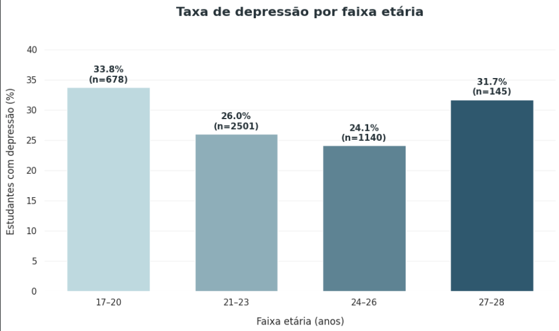

# Relatório

## Identificação

- **Nome**: André Torquato Pedreira
- **Cartão UFRGS:** 600986

## Dados utilizados

1. **Dataset 1**: https://www.kaggle.com/datasets/mkhoirulmustaqim/student-depression-detection-dataset/data
    * **Descrição curta**: Este dataset representa um conjunto de dados extraídos de um questionário realizado no google forms para a análise da presença de depressão entre os estudantes que fazem parte de alguma instituição de ensino superior. Além dessa informação, apresentada como variável-alvo, o conjunto de dados também contém características individuais dos participantes, incluindo aspectos sociais, econômicos e relacionados à saúde.

## Código-fonte da visualização

> [!IMPORTANT]
>
> - Indique abaixo onde está, dentro deste repositório, o código-fonte usado para gerar a visualização.
> - 
- **Arquivo principal**:  [lab3.ipynb](./lab3.ipynb) — Notebook Jupyter contendo o código-fonte da visualização (feito com google colab).

## Imagem da visualização gerada

> [!IMPORTANT]
>
> - Insira aqui uma imagem da visualização criada por você. Troque `imagem-da-visualizacao.png` pelo caminho correto do arquivo no repositório. 
> - Se você criou alguma visualização interativa, então descreva aqui como acessá-la. Por exemplo, se for uma página HTML, coloque o link, ou se for uma visualização 3D, descreva como compilar e executar o código. 

<mark>`<preencher abaixo>`</mark>

## Descrição da visualização

### Legenda (*caption*)
O primeiro gráfico mostra um gráfico de barras , onde cada barra representa um intervalo de notas de desempenho acadêmico universitário (Cumulative Grade Point Average) e a altura dessa barra representa a porcentagem de estudantes com depressão dentro de cada grupo definido por esse intervalo de notas. O uso da cor mais azulada na barra demonstra um intervalo com desempenho acadêmico melhor  , enquanto que a cor esverdeada revela um desempenho pior.

O segundo gráfico representa um gráfico de barras , onde cada barra engloba um grupo de estudantes que estão incluídos em um mesmo intervalo etário e a altura de cada barra representa a porcentagem de estudantes com depressão em relação ao grupo definido pelo intervalo etário. Dessa vez, a cor mais escura representa uma idade mais avançada ea mais clara indica um grupo de idade mais jovem. 

### Conclusão demonstrada pela visualização

Pode se concluir atráves da visualização que nos grupos de pior desempenho acadêmico há uma maior presença relativa de estudantes depressivos, e que nos grupos de melhor desempenho há uma presença relativa menor de estudantes deprimidos. Além disso, infere-se que os grupos etários mais jovem e o mais velho da amostra apresentam também uma maior presença relativa de estudantes com depressão , em relação aos grupos com idade intermediária. 

