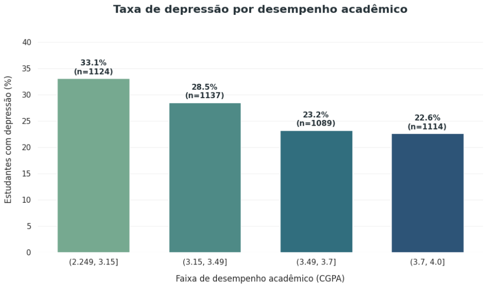

# Relatório

> [!CAUTION]
>
> - Você <ins>**não**</ins> **pode utilizar ferramentas de IA para escrever este relatório**.

## Identificação

- **Nome**: André Torquato Pedreira
- **Cartão UFRGS:** 600986

## Dados utilizados

> [!IMPORTANT]
>
> - Os dados utilizados devem ser informados como **links** para as fontes originais.
> - Se houver mais de um conjunto de dados, liste todos separadamente.
> - Para cada conjunto de dados, inclua também uma **descrição curta** explicando os dados.

1. **Dataset 1**: https://www.kaggle.com/datasets/mkhoirulmustaqim/student-depression-detection-dataset/data
    * **Descrição curta**: Este dataset representa um conjunto de dados extraídos de um questionário realizado no google forms respondido por 4464 estudantes , que possui como variáveis explicativas informações demográficas, acadêmicas, sociais, econômicas e de saúde e como variável alvo se o estudante se considera uma vítima de depressão.

## Código-fonte da visualização

> [!IMPORTANT]
>
> - Indique abaixo onde está, dentro deste repositório, o código-fonte usado para gerar a visualização.
> - 
- **Arquivo principal**:  [lab3.ipynb](./lab3.ipynb) — Notebook Jupyter contendo o código-fonte da visualização (feito com google colab).

## Imagem da visualização gerada

> [!IMPORTANT]
>
> - Insira aqui uma imagem da visualização criada por você. Troque `imagem-da-visualizacao.png` pelo caminho correto do arquivo no repositório. 
> - Se você criou alguma visualização interativa, então descreva aqui como acessá-la. Por exemplo, se for uma página HTML, coloque o link, ou se for uma visualização 3D, descreva como compilar e executar o código. 

<mark>`<preencher abaixo>`</mark>

(./faixaetaria.png)

## Descrição da visualização

### Legenda (*caption*)

> [!IMPORTANT]
>
> - Escreva um texto curto explicando como interpretar a visualização. Descreva os elementos visuais, eixos, cores, símbolos ou interações relevantes.
> - Este texto seria a legenda (*caption*) que acompanharia a figura em uma publicação, por exemplo.

<mark>`<preencher>`</mark>

### Conclusão demonstrada pela visualização

> [!IMPORTANT]
>
> - Escreva uma conclusão curta sobre os dados com base na visualização.
> - Explique qual insight, padrão ou tendência pode ser observado.

<mark>`<preencher>`</mark>
